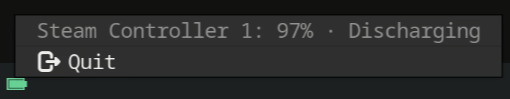

# Steam Controller Status

A Linux tray applet for the **2026 Steam Controller**. Shows each controller's
battery percentage and charge status, plus a Quit button. Works on Wayland;
Steam does not need to be running. Reads await HID reports using Tokio.



Inspired by [Steam Controller Battery Monitor](https://github.com/Pixel1011/Steam-Controller-Battery-Monitor), written in C++.

## Run

```sh
nix run path:.
# Or, with Rust:
cargo run --release --locked
```

Requires a StatusNotifierItem tray host: KDE, Waybar with its `tray` module, or
GNOME with an AppIndicator extension. USB-C and wireless receivers are supported;
Bluetooth support has not been hardware-tested.

## Configuration

Run with `--help` for all settings, defaults, and environment variables.
CLI flags override environment variables, which override defaults. For example:

```sh
SCAN_INTERVAL=5s nix run path:. -- --low-battery-threshold 25
```

Use `--demo` to preview two simulated controllers.

## NixOS

Import the flake's `nixosModules.default`, then enable:

```nix
programs.steam-controller-status = {
  enable = true;
  autostart = true; # Optional
};
```

The module installs the app and HID access rules. Reconnect the controller/puck
after rebuilding. Installing the package alone does not activate these rules.
